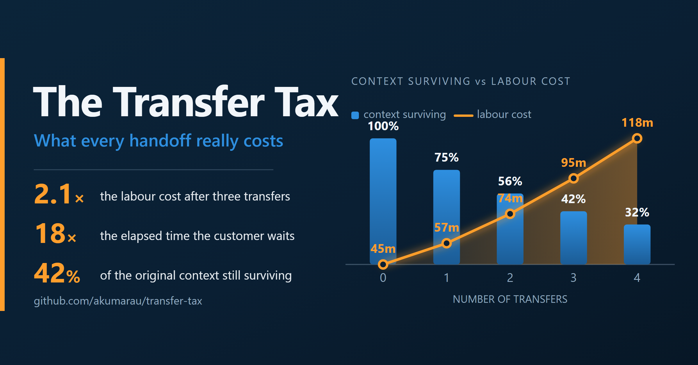
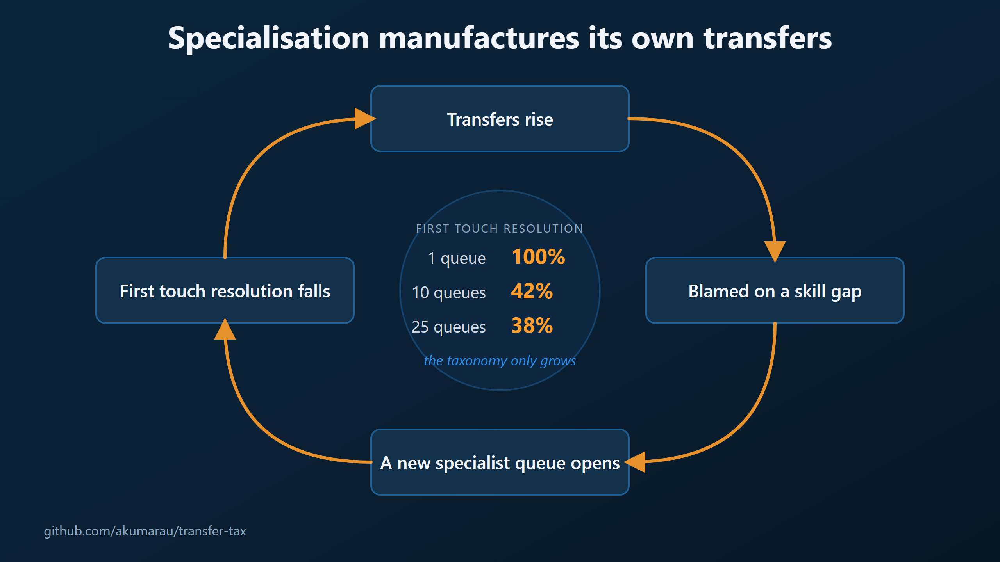

# The Transfer Tax

**What every case transfer actually costs, and how good a single owner has to be
before owning the case end to end beats routing it to a specialist.**

This repository is the working out behind the article
**[The Transfer Tax](https://www.linkedin.com/pulse/transfer-tax-anupam-kumar-girne/)**.
It exists so the argument can be checked rather than believed.

Everything here is runnable. Every number quoted in the article is produced by
`scripts/run_scenarios.py`, not typed into a slide.

```bash
git clone https://github.com/akumarau/transfer-tax
cd transfer-tax
python scripts/run_scenarios.py     # reproduces every figure in the article
python tests/test_model.py          # 43 property tests on the model
```

No dependencies. Standard library only, Python 3.9+.

---

## The claim in one line

The work a case requires is a property of the case. Everything your
organisation adds in order to move that case between people is overhead — and
that overhead is **convex**, so the fourth transfer costs more than the first.

## The model

### 1. The transfer tax

Each transfer costs three things: producing the handoff (`h`), waiting in the
next queue (`q`), and rebuilding the context that did not survive the move.

Context is not fully transmitted. If a handoff carries a fraction `ρ` of what
the previous owner knew, then after `i` handoffs the surviving context is `ρⁱ`,
and the cost of rebuilding what was lost is proportional to the loss.

```
Tax(n) = n·h + κ·( n − ρ(1−ρⁿ)/(1−ρ) )

L(n)   = W + Tax(n)            labour minutes
E(n)   = L(n) + n·q            elapsed minutes, as the customer experiences it
```

| symbol | meaning |
|---|---|
| `W` | irreducible productive work the case requires |
| `h` | cost of producing a handoff |
| `κ` | cost of reconstructing the case context from nothing |
| `ρ` | fraction of context surviving each handoff, in (0,1] |
| `q` | requeue delay per transfer |
| `n` | number of transfers |

The two properties that carry the argument:

```
cost of the n-th transfer    = h + κ(1 − ρⁿ)         > 0
increase over the previous   = κ·ρⁿ·(1 − ρ)          > 0  for ρ < 1   ← convex
```

In the limit each transfer costs `h + κ` — the case is restarted from scratch
every time it moves.

(The real-valued extension is also smooth and convex, with
`d²Tax/dn² = κ·ρⁿ⁺¹·ln(ρ)²/(1−ρ) > 0`, which is what licenses the Jensen
argument in §4. `continuous_slope` and `curvature` are verified against
numerical differentiation in the tests.)

**Base scenario** (`W`=45, `h`=6, `κ`=25, `ρ`=0.75, `q`=240 minutes):

| transfers | context left | labour | vs. no transfer | elapsed | vs. no transfer |
|---:|---:|---:|---:|---:|---:|
| 0 | 100% | 45 min | 1.00× | 45 min | 1.0× |
| 1 | 75% | 57 min | 1.27× | 297 min | 6.6× |
| 2 | 56% | 74 min | 1.65× | 554 min | 12.3× |
| 3 | 42% | 95 min | **2.10×** | 815 min | **18.1×** |
| 4 | 32% | 118 min | 2.62× | 1,078 min | 23.9× |
| 5 | 24% | 143 min | 3.17× | 1,343 min | 29.8× |

Three transfers more than double the labour cost and multiply elapsed time
eighteenfold. Successive transfers cost 12.3 → 16.9 → 20.5 → 23.1 minutes,
climbing toward an asymptote of 31.

### 2. Where transfers come from

Adding a specialist queue does not add information at intake. So if `a` is the
fraction of cases whose destination is unambiguous on arrival, and the rest are
effectively spread across `m` queues:

```
α(m) = a + (1 − a)/m          routing accuracy
E[n] = 1/α(m) − 1             expected transfers
```

`α(1) = 1` by construction: a single pool cannot misroute. With `a` = 35%:

| specialist queues | routing accuracy | expected transfers | labour per case |
|---:|---:|---:|---:|
| 1 | 100% | 0.00 | 45 min |
| 5 | 48.0% | 1.08 | 59 min |
| 10 | 41.5% | 1.41 | 64 min |
| 25 | 37.6% | 1.66 | 68 min |
| 100 | 35.6% | 1.81 | 71 min |

This is a loop, not a line. Transfers get diagnosed as a skill gap, so the
organisation stands up another specialist queue, which lowers routing accuracy,
which produces more transfers. `m` only ever goes up.



### 3. The pooling penalty

A separate and additive cost, and the one nobody books. This is not a
mis-routing cost — it assumes **perfect** routing. It is purely the price of
forbidding an idle agent from helping a waiting customer who has been labelled
as somebody else's problem.

Computed with exact Erlang C (`transfer_tax/pooling.py`), 100 Erlangs offered
load, 30-minute AHT:

**Hold service level fixed, pay in headcount** (80% answered in 5 minutes):

| pools | load/pool | agents/pool | total FTE | extra | vs. pooled |
|---:|---:|---:|---:|---:|---:|
| 1 | 100.0 | 106 | 106 | 0 | — |
| 5 | 20.0 | 24 | 120 | 14 | +13.2% |
| 10 | 10.0 | 13 | 130 | 24 | +22.6% |
| 25 | 4.0 | 7 | 175 | 69 | **+65.1%** |

**Hold headcount fixed, pay in waiting time** — 120 agents, 100 Erlangs,
identical 83.3% utilisation in every row. Only the boundaries change:

| pools | agents/pool | E[Wq] | vs. pooled |
|---:|---:|---:|---:|
| 1 | 120 | 0.05 min | 1× |
| 2 | 60 | 0.35 min | 7× |
| 5 | 24 | 2.24 min | 45× |
| 10 | 12 | 6.74 min | **135×** |

Same people. Same work. Same utilisation. A hundred and thirty-five times the
wait, created entirely by drawing lines between them.

### 4. The break-even is your existing first-touch resolution rate

Owner-first beats transfer-first when the transfers avoided outweigh the ones
caused. This does not need to be solved numerically. It collapses.

**Theorem (common continuation).** Let `α` be the probability that the first
team to touch a case *resolves* it under transfer-first, and `p` the same under
a single owner. Let `C` be the expected penalty of a case that fails its first
touch and enters the escalation chain, including that first move. If `C` is the
same for both designs, then

```
transfer-first : pays 0 with probability α, else C   →  (1−α)·C
owner-first    : pays 0 with probability p, else C   →  (1−p)·C

owner-first cheaper  ⟺  (1−p)·C < (1−α)·C  ⟺  p > α                        ∎
```

`C` cancels. The chain may have accuracy that degrades with depth, path
dependence, absorbing states, correlated difficulty, any cost function at all.
None of `h`, `κ`, `ρ` or `W` appears in the answer.

`test_general_identity_holds_for_arbitrary_chains` verifies the crossover for
degrading, improving, flat and erratic chains, under both the labour and
elapsed-time cost functions. `test_general_identity_crossover_is_exact` locates
it by bisection to 1e-12. `test_general_identity_independent_of_handoff_parameters`
confirms `h`, `κ` and `ρ` cannot move it.

**Two things this is not.**

*It is not distribution-free cancellation.* It is cancellation under a **common
continuation**, which is an economic assumption, not a free lunch. It fails in
both directions. Cases that defeat a competent owner are genuinely hard, while
cases a router misdirects are mostly ordinary cases sent to the wrong place —
that adverse selection pushes the true break-even **above** α. But an escalated
case from an owner arrives with real diagnostic work and a reasoned referral
rather than a bounce from a team that only knows the case is not theirs, which
pushes it **below**. Neither is modelled. α is the neutral estimate; treat it as
a floor if you think your escalations are badly selected and a ceiling if you
think your owners hand over well.

*α is first-touch **resolution**, not routing accuracy.* A case can land in
exactly the right queue and still be bounced, and a case in the wrong queue is
sometimes resolved anyway. The theorem is about the measurable quantity: the
fraction of cases finished by the team they were first assigned to, with no
reassignment. `routing_accuracy(m, a)` is an explicitly labelled toy that tells
a story about *why* that number falls as an organisation fragments — it is not a
substitute for measuring it.

**What it means.**

> Is your single owner better at resolving a case at first contact than your
> current front line already is?

That is the entire comparison. Both designs face an identical downstream; only
the first touch differs. And because first-touch resolution falls as an
organisation fragments, **the more specialist queues you run, the lower the bar
your generalist has to clear.**

For comparison, the geometric special case gives the same answer, and the naive
plug-in `Tax(E[n])` gives 45.7%. The plug-in is wrong, and wrong in the
conservative direction — `Tax` is convex, so by Jensen `Tax(E[n]) ≤ E[Tax(n)]`,
and it understates the true cost of transferring by 28% here. `breakeven_fcr`
retains it only for comparison; use `breakeven_general` or `breakeven_fcr_exact`.

### 5. Magnitude: breaking even is not a reason to reorganise

The handoff parameters do not set the bar. They set how much you win by.

| Owner FCR | Labour saving | Elapsed saving |
|---:|---:|---:|
| 37.6% (break-even) | 0% | 0% |
| 55% | 11.0% | 25.2% |
| 65% | 17.4% | 39.7% |
| 70% | 20.5% | 47.0% |
| 80% | 26.9% | 61.5% |

**Elapsed savings run roughly 2.3× the labour savings**, because requeue delay
dominates elapsed time and is charged entirely to the customer. A business case
built on cost alone argues for less than half the actual prize.

### 6. What agentic AI has to deliver

Let γ be the **augmentation yield** — the fraction of the generalist's knowledge
gap that AI closes:

```
p_effective = p_generalist + γ · (p_specialist − p_generalist)
```

Getting an owner from ~38% unaided to the ~70% that produces a 20% labour and
47% elapsed improvement requires **γ ≈ 60%**.

Brynjolfsson, Li & Raymond's field study of 5,172 support agents (NBER 31161 /
QJE) measured a 14–15% average productivity gain — **concentrated among less
experienced and lower-skilled workers, with the most experienced agents seeing
small gains in speed and small declines in quality.**

Two things must be said about using that number. It measures **issues resolved
per hour**, which is throughput, not the **probability of first-contact
resolution**, which is capability. They are different quantities and the mapping
is not one-to-one. And the magnitude is well short of γ ≈ 60%.

What the study does establish, unambiguously, is the *shape*: AI compresses the
generalist-to-specialist gap specifically, rather than lifting everyone
uniformly. That is the parameter the single-owner model was always missing.
Whether agentic systems — which act rather than suggest — reach γ ≈ 60% is a
bet, but it is a bet on a mechanism already measured working in the right
direction on the right people.

### 7. The assumptions that could sink this

The break-even does not depend on ρ, κ, h or W at all, so the usual parameter
sweep does not apply to it. It applies to the savings. Three limitations are
worth more than the sweep, and all three are computed in
`scripts/run_scenarios.py`.

**(a) W is not really invariant — this is the big one.** A specialist who has
seen a failure forty times needs less time than a generalist reasoning from
first principles. If owner-first adds δ extra productive minutes per case, the
break-even becomes `p* = α + δ/C`, where `C` is the chain cost:

| extra owner minutes | break-even |
|---:|---:|
| 0 | 37.6% |
| 5 | 48.2% |
| 10 | 58.8% |
| 20 | 80.0% |
| 25 | 90.6% |

Twenty extra minutes and the argument is in serious trouble. This is the number
most worth measuring against real data, and `breakeven_with_owner_overhead`
computes it.

**(b) Convexity is assumed, not derived.** Lossy handoffs alone do not produce a
convex tax. The convex form assumes context a receiver rebuilds does *not* fully
re-enter the transferable record. If every receiver fully restores the case and
hands on a complete record, re-discovery cost is linear:

| transfers | convex | linear |
|---:|---:|---:|
| 2 | 1.65× | 1.54× |
| 3 | **2.10×** | **1.82×** |
| 4 | 2.62× | 2.09× |

Both are defensible readings of "a handoff transmits a fraction ρ". The headline
uses the convex form; `linear_transfer_tax` provides the other so the difference
can be seen rather than argued about. The break-even identity is unaffected
either way — it never depended on the shape of the tax.

**(c) Do not double-count the waiting.** The requeue term `q` in the case model
and the pooling penalty in §3 describe overlapping phenomena: both are
fragmentation-induced waiting. The *staffing* cost of fragmentation is genuinely
additive to the case-level tax. The *waiting time* is not. Do not add the two
waiting figures together.

---

## Put your own numbers in

The defaults are illustrative. The point of publishing this is that you can
replace them.

```python
from transfer_tax import (
    CaseParams, breakeven_general, breakeven_with_owner_overhead,
    savings_fraction, labour_minutes,
)

mine = CaseParams(
    W=90,      # your real productive work per case
    h=10,      # how long a proper handoff actually takes
    kappa=40,  # how long a cold pickup takes to get productive
    rho=0.65,  # be honest about this one
    q=480,     # your real requeue delay
)

alpha = 0.41   # MEASURE THIS: fraction resolved by the first team assigned

print(labour_minutes(3, mine))                          # cost of a 3-transfer case
print(breakeven_general([alpha]))                       # the bar: it is just alpha
print(breakeven_with_owner_overhead(alpha, 10, mine))   # bar if owners need 10 min more
print(savings_fraction(0.70, 25, 0.35, mine, elapsed=True))
```

Note which function you want. `breakeven_general` is the theorem.
`breakeven_fcr` is the naive plug-in, retained only so the difference can be
seen — do not use it for anything real.

Three parameters you can measure this quarter and probably do not:

- **ρ** — take fifty transferred cases, ask the receiving engineer what fraction
  of the context they had to rebuild. That is `1 − ρ`.
- **a** — what fraction of your cases are resolved by the team they were first
  assigned to, without any reassignment. That is your empirical `α`.
- **κ** — time from case pickup to first substantive customer contact, on cases
  the engineer did not originate.

If ρ turns out higher than 0.75 and `a` higher than 0.5, the argument weakens.
Run it and find out. That is what the repository is for.

---

## Layout

```
transfer_tax/model.py       transfer tax, routing accuracy, break-even
transfer_tax/pooling.py     exact Erlang C, pooled vs fragmented queues
scripts/run_scenarios.py    reproduces every figure in the article
tests/test_model.py         27 property tests: convexity, monotonicity, bounds
RESEARCH.md                 annotated bibliography, and the claims I rejected
```

`RESEARCH.md` is worth a look even if the code is not. It includes a list of
widely-repeated statistics in this field that did not survive fact-checking —
including one I had intended to build the article around.

## Contributing

Corrections welcome, especially to the model. The most useful contribution would
be real measured values of ρ, κ and `a` from an actual support organisation.
Anonymised is fine.

## Licence

MIT. Use it, fork it, argue with it.

Article: **[The Transfer Tax](https://www.linkedin.com/pulse/transfer-tax-anupam-kumar-girne/)**
(also in [ARTICLE.md](ARTICLE.md))

— [Anupam Kumar](https://www.linkedin.com/in/anupamkumarau/)
